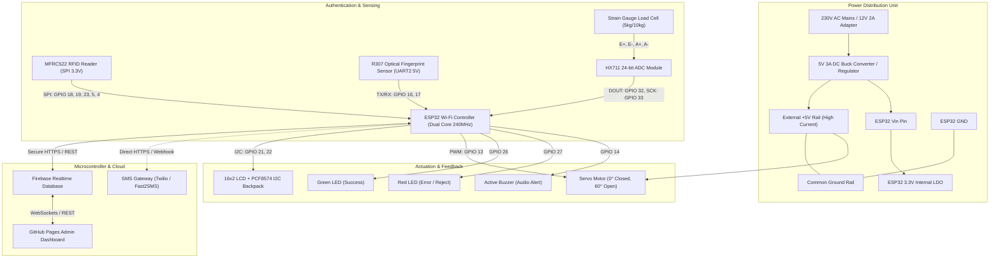

# Circuit Diagram & Hardware Schematics
## Project: Smart Public Ration Distribution System Using RFID Authentication and Real-Time SMS Notifications
**Main Controller:** ESP32 DevKit V1 (30/38 Pin)

---

## 1. System Block Diagram



---

## 2. Complete ESP32 Pin-to-Pin Connection Table

| Component | Component Pin | ESP32 Pin | Operating Voltage | Connection Type / Protocol | Description / Function |
| :--- | :--- | :--- | :--- | :--- | :--- |
| **MFRC522 RFID** | VCC | **3.3V** | 3.3V (Strict) | Power | **DO NOT connect to 5V** (Damages RC522) |
| | GND | **GND** | 0V | Ground | System common ground |
| | RST | **GPIO 4** | 3.3V | Digital Out | RFID module hardware reset |
| | SDA / SS | **GPIO 5** | 3.3V | VSPI CS | SPI Chip Select |
| | SCK | **GPIO 18** | 3.3V | VSPI CLK | SPI Clock |
| | MISO | **GPIO 19** | 3.3V | VSPI MISO | SPI Master-In Slave-Out |
| | MOSI | **GPIO 23** | 3.3V | VSPI MOSI | SPI Master-Out Slave-In |
| | IRQ | *NC (Leave Unconnected)* | - | - | Interrupt not required |
| **16x2 I2C LCD** | VCC | **5V (VIN)** | 5.0V | Power | Powers backlight and display driver |
| | GND | **GND** | 0V | Ground | System common ground |
| | SDA | **GPIO 21** | 3.3V/5V | I2C Data | Serial Data (Internal pullup) |
| | SCL | **GPIO 22** | 3.3V/5V | I2C Clock | Serial Clock (Internal pullup) |
| **R307 Fingerprint** | VCC (Red) | **5V (VIN)** | 5.0V | Power | Optical LED & processor power (~120mA) |
| | GND (Black) | **GND** | 0V | Ground | System common ground |
| | TX (Yellow) | **GPIO 16** | 3.3V/5V | UART2 RX2 | R307 Transmit $\rightarrow$ ESP32 Receive |
| | RX (Green) | **GPIO 17** | 3.3V/5V | UART2 TX2 | ESP32 Transmit $\rightarrow$ R307 Receive |
| **HX711 Load Cell** | VCC | **5V / 3.3V** | 3.3V - 5V | Power | Power for excitation circuit |
| | GND | **GND** | 0V | Ground | Common Ground |
| | DT / DOUT | **GPIO 32** | 3.3V | Digital In | Serial Data Output from ADC |
| | SCK | **GPIO 33** | 3.3V | Digital Out | Serial Clock Input to ADC |
| **Servo Motor** | Signal (Orange/Yellow) | **GPIO 13** | 3.3V PWM | PWM Output | Controls valve angle (0° to 60°) |
| | VCC (Red) | **Ext +5V** | **5.0V External** | Power | **Connect to External 5V 2A Supply** |
| | GND (Brown/Black) | **Ext GND** | 0V | Ground | **Common Ground with ESP32** |
| **Green LED** | Anode (+) | **GPIO 26** | 3.3V | Digital Out | Through 330 $\Omega$ Resistor |
| | Cathode (-) | **GND** | 0V | Ground | Common Ground |
| **Red LED** | Anode (+) | **GPIO 27** | 3.3V | Digital Out | Through 330 $\Omega$ Resistor |
| | Cathode (-) | **GND** | 0V | Ground | Common Ground |
| **Active Buzzer** | Positive (+) | **GPIO 14** | 3.3V | Digital Out | Through 100 $\Omega$ Resistor |
| | Negative (-) | **GND** | 0V | Ground | Common Ground |
| **Stage 2 Confirm** | Onboard `BOOT` | **GPIO 0** | 3.3V (Pull-Up) | Digital In | Built-in button on ESP32 DevKit (confirm Ragi vessel swap) |

---

## 3. Load Cell 4-Wire Wheatstone Bridge Wiring to HX711

Standard 4-wire strain gauge load cells (5kg / 10kg aluminum bar):

```
       Load Cell Wires                       HX711 Board Terminals
    +-------------------+                    +--------------------+
    |  RED Wire         | -----------------> | E+ (Excitation +)  |
    |  BLACK Wire       | -----------------> | E- (Excitation -)  |
    |  WHITE Wire       | -----------------> | A- (Signal -)      |
    |  GREEN Wire       | -----------------> | A+ (Signal +)      |
    |  YELLOW (Shield)  | -----------------> | GND (Optional)     |
    +-------------------+                    +--------------------+
```

---

## 4. Power Architecture & Critical Brownout Protection

> [!CAUTION]
> **Servo Motor & Brownout Prevention Rule:**
> An ESP32 operating with Wi-Fi enabled consumes up to 250mA peak. When the servo motor (MG995 or SG90) starts rotating or stalls, it pulls a transient spike between **500mA and 1.2A**. If the servo is powered from the ESP32 board's onboard 3.3V or USB 5V pin, this current surge drops the rail voltage below 2.7V, causing the ESP32 to trigger a **Hardware Brownout Reset**.

### Recommended Power Schematic:
1. Provide a **5V 2.5A / 3A DC Regulated Power Adapter** (or USB-C 5V 3A supply).
2. Split the +5V line:
   - One branch powers the **ESP32 VIN pin** (onboard LDO converts 5V to 3.3V for ESP32 and RFID).
   - One branch powers the **Servo VCC pin**, **16x2 LCD VCC**, and **R307 Sensor VCC**.
3. Place a **470 $\mu$F to 1000 $\mu$F electrolytic capacitor** directly across the Servo VCC and GND terminals to buffer dynamic current spikes.
4. **Tie ALL Grounds together** to a single point (star grounding).

---

## 5. Mechanical Grain Dispensing Mechanism (Hopper & Shutter)

```
        [ GRAIN STORAGE HOPPER (Rice / Wheat) ]
                         |
                         v (Gravity Feed)
                 +---------------+
                 |  Funnel Chute |
                 +---------------+
                         |
            +------------+------------+
            |  Servo Shutter Flapper  | <--- Connected to Servo Horn (GPIO 13)
            |  0° = Fully Closed      |      0°: Horizontal barrier stops flow
            |  60° = Open Aperture    |      60°: Rotates open, grain pours down
            +------------+------------+
                         |
                         v
       +-----------------------------------+
       |    Beneficiary Container / Bag    |
       +-----------------------------------+
                         |
       =====================================
       [  LOAD CELL WEIGHING PLATFORM (HX711) ]  <--- Continuous feedback to ESP32
       =====================================
                         |
                 [ Rigid Base Frame ]
```
